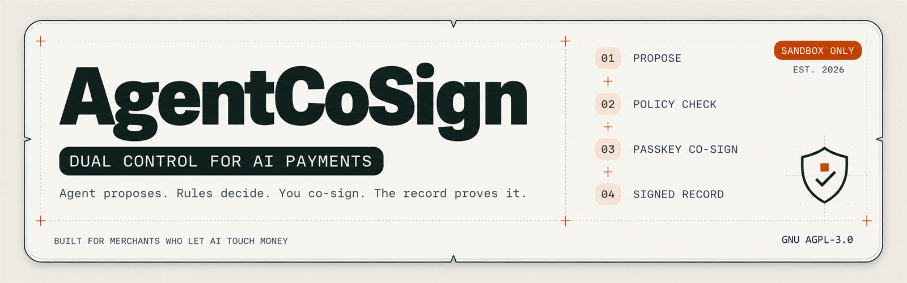

<p align="center">
  
</p>

# AgentCoSign

**Dual control for AI agents that move money on PayPal.** The agent proposes. Deterministic policy decides. A human co-signs risky actions on their phone. Every step lands in a tamper-evident ledger.

[](LICENSE)
[](https://www.python.org/)
[](https://fastapi.tiangolo.com/)

> Built during the **PayPal AI Hackathon 2026** (submission period Oct 1 – Nov 12, 2026). Sandbox only; no real funds.

## For judges and reviewers (60 seconds)

| I want to… | Do this |
|---|---|
| See it | Video: _link added at submission_ · Hosted demo: _link added at submission_ (first load may take ~60 s on a free tier) |
| Run it with **no credentials** | `pip install -e ".[dev]" && pytest && uvicorn agentcosign.main:app` or `docker build -t agentcosign . && docker run -p 8000:8000 agentcosign` |
| Understand the design | [Architecture](docs/ARCHITECTURE.md) · [Threat model](docs/THREAT_MODEL.md) · [Decisions](docs/DECISIONS.md) |
| Use my own PayPal sandbox | [Testing guide](docs/TESTING.md) and `.env.example` |
| Review the exact submitted code | Tag `v1.0-submission` (created at freeze) |

**Honesty note on "hermetic" mode:** by default the policy engine, approval flow and ledger run as real code, while PayPal execution comes from *recorded real-sandbox evidence* (stated on the landing page and in `/health`). Set sandbox keys and `AGENTCOSIGN_PAYPAL_EXECUTION=sandbox` to send refunds to the PayPal sandbox.

## The problem

PayPal's Agent Toolkit exposes money-out tools (`create_refund`, `accept_dispute_claim`, `pay_order`, …) with only an **on/off switch per tool**: no amount limit, no velocity limit, no approval step. A merchant must choose between *unbounded loss exposure* and *no automation*. A prompt-injected "refund $4,900", a hallucinated amount or a retry loop can move money nobody approved.

## The solution

| Role | Who | Can do | Cannot do |
|---|---|---|---|
| **Maker** | AI agent (no PayPal credentials) | Propose allowlisted money actions (refund, dispute acceptance, payout) | Approve, read raw audit, call PayPal directly |
| **Policy** | Deterministic engine, rules R1–R15 | Allow / escalate / deny; strictest wins | Be overridden by an LLM |
| **Checker** | Human on a mobile PWA, passkey co-sign | Approve or reject escalations | Propose on the agent's behalf |
| **Auditor** | Read-only key | Verify the ledger | Mutate anything |

**Bounded loss, proven by a property test:** auto-executed outflow never exceeds the configured rolling-24h cap, and refunds sent without asking never exceed the auto limit per order, or per customer in 24 hours (defaults $25 / $1,000).

### Policy rules (limits live in [`config.yaml`](config.yaml); invariants are not configurable)

| Rule | Condition | Outcome |
|---|---|---|
| R1 | Refund ≤ auto limit, clean evidence | ALLOW |
| R2 | Auto limit < refund ≤ max limit | ESCALATE (passkey co-sign) |
| R3 | Refund > max limit | DENY |
| R4 | Cumulative refunds (executed + reserved) exceed captured amount | DENY |
| R5 | > N refunds for one customer in 24 h | PAUSE: held until the customer is back under the limit, then decided again automatically from fresh PayPal facts; the customer gets a kind, fixed message with an update time; nobody can send it early, the merchant can decline |
| R6 | Order has an open dispute | ESCALATE |
| R7 | Any dispute-claim acceptance | ESCALATE (always) |
| R8 | New/changed payee (payouts, optional) | ESCALATE |
| R9 | Duplicate payee + amount + reference in window (payouts, optional) | DENY |
| R10 | Rolling-24h outflow cap would be exceeded | DENY |
| R11 | Prompt injection detected | DENY + log |
| R12 | Any error, schema mismatch or unknown tool | DENY (fail closed) |
| R13 | Currency or account mismatch | DENY |
| R14 | Agent claims differ from PayPal evidence, or evidence changed before execution | DENY (asks the person again when only refunds or dispute state changed) |
| R15 | Screening unavailable | ESCALATE |
| R16 | The merchant pressed the emergency stop | DENY every money action; only the merchant's fingerprint turns refunds back on |
| R17 | Refunds sent without asking would pass the auto limit for the order, or for the customer in 24 h | ESCALATE (one refund cannot be split into several small automatic ones). Takes effect once the safety check of customer messages ships; until then every refund already asks the owner |

### Three AI roles (designed; models verified live, roles not yet wired into the request path)
AI reads and checks; it never approves money. A refund goes out without the merchant only when three independent witnesses agree: the agent's proposal, a separate reading of the customer's own words, and the facts PayPal returns. Any disagreement goes to the merchant.

1. **Acting agent** (Groq `openai/gpt-oss-120b`) reads the customer's message and proposes a refund through the gateway. It holds no PayPal credentials.
2. **Extraction** (Groq `qwen/qwen3.8-27b`, a different model family from the agent) reads the customer's own words for the order, amount, currency, reason and any request to send money elsewhere. Startup refuses a configuration that gives this role the agent's own model.
3. **Screening** (Groq `openai/gpt-oss-safeguard-20b`) looks for manipulation across the customer's messages, after a deterministic pre-screen.

The approval card shows what the customer asked for as a fixed sentence built from the extracted fields, so no model writes text the merchant reads. Customer words go only to providers whose terms let the account turn off prompt retention and rule out training on prompts; startup refuses any other provider for these roles.

## Status (updated honestly)

| Component | Status |
|---|---|
| Strict fail-closed config, security headers, domain types, offline test suite, CI, container | ✅ Built (CI and the container image verified green) |
| Hosted demo on Render with traffic protection (per-client limits, penalty box, reserved reviewer capacity, daily live-call pools), landing page, API reference | ✅ Built and verified on the live host |
| Policy engine R1–R17 plus execution-drift check: 100-row scenario table, property tests for bounded exposure | ✅ Built and called by the propose route |
| Ledger (hash chain + HMAC, atomic reservations), PayPal evidence fetcher, idempotent executor with a hard cap just before each PayPal call, retry of unanswered refunds with the same request id, propose and approve API | ✅ Built; sandbox refunds executed end to end from a real phone |
| Screening and extraction in the request path | 🚧 Planned (models verified live with single samples; accuracy not yet measured). Until then every request says the safety check did not run and asks a person |
| Mobile PWA approver with WebAuthn passkey co-sign (approval bound to the exact refund) | ✅ Built; tested on a real Android phone against the PayPal sandbox. Not yet on the hosted demo |
| Audit viewer | 🚧 Planned |
| Payouts adapter, PayPal webhooks, native Android approver | ⏳ Optional |

## Results

_Populated before submission with the commit hash and date they were produced: policy scenarios (target 100%), layered injection block rate on a held-out set with 95% interval and the policy-only number, benign false-positive rate, extraction accuracy, p95 decision latency, ledger tamper detection, executed actions with PayPal sandbox IDs._

## Tech stack

Python 3.12+ · FastAPI · Pydantic v2 · PayPal Sandbox REST (the official `paypal-agent-toolkit` is an optional extra: it supports Python < 3.14 only) · Groq and NVIDIA NIM via OpenAI-compatible SDK · SQLite (WAL) · WebAuthn · Ruff, mypy, bandit, pytest, hypothesis, gitleaks.

## Develop

```bash
python -m venv .venv && source .venv/bin/activate     # Windows: .venv\Scripts\Activate.ps1
pip install -e ".[dev]"
bash tools/hooks/install.sh     # optional: lint, format, type, secret-scan and test gates on commit/push
pytest                          # offline, no credentials
pytest -m integration           # live checks, needs keys
ruff check . && ruff format --check . && mypy agentcosign/ && bandit -r agentcosign/
```

## Legal

Independent open-source project, not affiliated with, sponsored by or endorsed by PayPal Holdings, Inc., Groq, Inc., NVIDIA Corporation or Google LLC. PayPal, Groq, NVIDIA, NVIDIA NIM and Gemma are trademarks of their respective owners. Models are accessed through the providers' hosted APIs under their own model licences; weights are not redistributed. A commercial deployment needs a licence check.

## Author and licence

Vikas Sahani ([@VIKAS9793](https://github.com/VIKAS9793)) · [vikassahani17@gmail.com](mailto:vikassahani17@gmail.com) · [MIT License](LICENSE)
