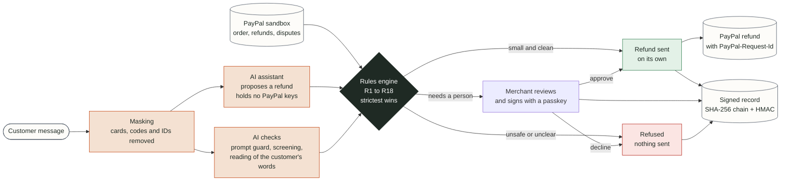
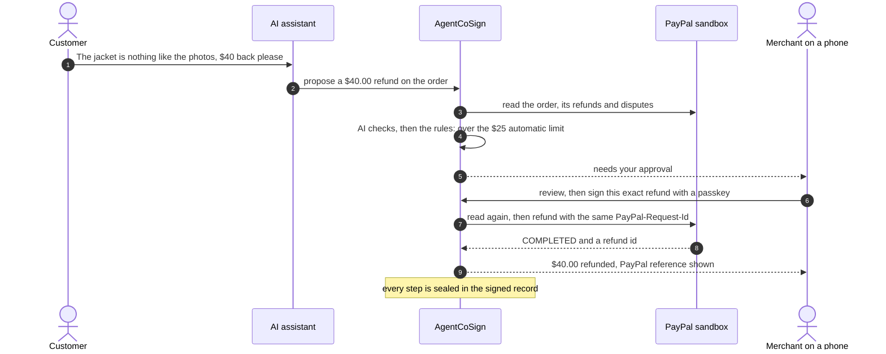

<p align="center">
  
</p>

# AgentCoSign

**Dual control for AI agents that move money on PayPal.** The agent proposes. Deterministic policy decides. A human co-signs risky actions on their phone. Every step lands in a tamper-evident ledger.

<p align="center">
  <a href="https://youtu.be/MBnqli0L1aI"></a>
  &nbsp;
  <a href="https://agentcosign-demo.onrender.com"></a>
</p>

<p align="center">
  <a href="https://github.com/VIKAS9793/AgentCoSign/actions/workflows/ci.yml"></a>
  <a href="LICENSE"></a>
  
  <a href="https://agentcosign-demo.onrender.com"></a>
</p>

<p align="center">
  <a href="https://www.python.org/"></a>
  <a href="https://fastapi.tiangolo.com/"></a>
  <a href="https://docs.pydantic.dev/"></a>
  <a href="https://www.python-httpx.org/"></a>
  <a href="https://www.sqlite.org/"></a>
  <a href="https://github.com/duo-labs/py_webauthn"></a>
</p>

<p align="center">
  <a href="https://developer.paypal.com/"></a>
  <a href="https://groq.com/"></a>
</p>

<sub>Versions are the ones tested locally; the container installs the newest release inside each range pinned in <code>pyproject.toml</code>.</sub>

> Built during the **PayPal AI Hackathon 2026** (submission period Oct 1 – Nov 12, 2026). Sandbox only; no real funds.

## How it works



A refund that needs the merchant, end to end:



More detail: [Architecture](docs/ARCHITECTURE.md) (components, trust boundaries, state machine, API) · [Threat model](docs/THREAT_MODEL.md) · [Decisions](docs/DECISIONS.md).

## For judges and reviewers (60 seconds)

| I want to… | Do this |
|---|---|
| See it | [Video (2:28)](https://youtu.be/MBnqli0L1aI) · [Hosted demo](https://agentcosign-demo.onrender.com) (free tier: the first load may take ~60 s, and test data resets when it sleeps) |
| Try it on the hosted demo (2 minutes) | 1. Open the link on a phone or laptop and set up with your fingerprint, face or PIN: you get your own private test workspace. 2. Press **Try a scenario**: each one creates a real PayPal sandbox order, then a customer message goes through the AI checks and the rules (or write your own message). 3. Switch on **Behind the scenes** in the top bar to watch every backend step live beside the app: PayPal calls with PayPal's own ids, each model's answer, the rules' decision in plain words, the signed record, and an outcome block saying what happened to the money |
| Run it with **no credentials** | `pip install -e ".[dev]" && pytest && uvicorn agentcosign.main:app` or `docker build -t agentcosign . && docker run -p 8000:8000 agentcosign` |
| Understand the design | [Architecture](docs/ARCHITECTURE.md) · [Threat model](docs/THREAT_MODEL.md) · [Decisions](docs/DECISIONS.md) |
| Use my own PayPal sandbox | [Testing guide](docs/TESTING.md) and `.env.example` |
| Review the exact submitted code | Tag `v1.0-submission` (created at freeze) |

**Honesty note on modes:** the hosted demo runs live: real PayPal sandbox calls and live AI models. A local run with no keys is "hermetic": the policy engine, approval flow and ledger run as real code, while PayPal execution comes from *recorded real-sandbox evidence*. Each mode is stated in `/health` (`paypal_execution`, `ai_models`) and in the behind-the-scenes panel. Set sandbox keys and `AGENTCOSIGN_PAYPAL_EXECUTION=sandbox` to send refunds to the PayPal sandbox yourself.

## The problem

PayPal's Agent Toolkit exposes money-out tools (`create_refund`, `accept_dispute_claim`, `pay_order`, …) with only an **on/off switch per tool**: no amount limit, no velocity limit, no approval step. A merchant must choose between *unbounded loss exposure* and *no automation*. A prompt-injected "refund $4,900", a hallucinated amount or a retry loop can move money nobody approved.

## The solution

| Role | Who | Can do | Cannot do |
|---|---|---|---|
| **Maker** | AI agent (no PayPal credentials) | Propose allowlisted money actions (refund, dispute acceptance, payout) | Approve, read raw audit, call PayPal directly |
| **Policy** | Deterministic engine, rules R1–R18 | Allow / escalate / pause / deny; strictest wins | Be overridden by an LLM |
| **Checker** | Human on a mobile PWA, passkey co-sign | Approve or reject escalations | Propose on the agent's behalf |
| **Auditor** | Read-only key | Verify the ledger | Mutate anything |

**Bounded loss, proven by a property test:** auto-executed outflow never exceeds the configured rolling-24h cap, and refunds sent without asking never exceed the auto limit per order, or per customer in 24 hours (defaults $25 / $1,000).

### Policy rules (limits live in [`config.yaml`](config.yaml); invariants are not configurable)

| Rule | Condition | Outcome |
|---|---|---|
| R1 | Refund ≤ auto limit, clean evidence | ALLOW |
| R2 | Auto limit < refund ≤ max limit | ESCALATE (passkey co-sign) |
| R3 | Refund > max limit | DENY |
| R4 | Cumulative refunds (executed + reserved) exceed captured amount | DENY |
| R5 | > N refunds for one customer in 24 h | PAUSE: held until the customer is back under the limit, then decided again automatically from fresh PayPal facts; the customer gets a kind, fixed message with an update time; nobody can send it early, the merchant can decline |
| R6 | Order has an open dispute | ESCALATE |
| R7 | Any dispute-claim acceptance | ESCALATE (always) |
| R8 | New/changed payee (payouts, optional) | ESCALATE |
| R9 | Duplicate payee + amount + reference in window (payouts, optional) | DENY |
| R10 | Rolling-24h outflow cap would be exceeded | DENY |
| R11 | Prompt injection detected | DENY + log |
| R12 | Any error, schema mismatch or unknown tool | DENY (fail closed) |
| R13 | Currency or account mismatch | DENY |
| R14 | Agent claims differ from PayPal evidence, or evidence changed before execution | DENY (asks the person again when only refunds or dispute state changed) |
| R15 | Screening unavailable | ESCALATE |
| R16 | The merchant pressed the emergency stop | DENY every money action; only the merchant's fingerprint turns refunds back on |
| R17 | Refunds sent without asking would pass the auto limit for the order, or for the customer in 24 h | ESCALATE (one refund cannot be split into several small automatic ones) |
| R18 | The customer's own message, read separately from the assistant, does not ask for exactly this refund (different or missing order or amount, other currency, money asked to go elsewhere), or gives a reason PayPal's record for the order cannot confirm (charged twice, an earlier refund missing, an unrecognised charge, a change of mind) | ESCALATE (a reading never refuses on its own) |

### Four AI roles (wired into the request path for refunds that come with a customer message)
AI reads and checks; it never approves money. A refund goes out without the merchant only when three independent witnesses agree: the agent's proposal, a separate reading of the customer's own words, and the facts PayPal returns. Any disagreement goes to the merchant.

1. **Acting agent** (Groq `openai/gpt-oss-120b`) reads the customer's message and proposes a refund through the gateway. It holds no PayPal credentials.
2. **Extraction** (Groq `qwen/qwen3.8-27b`, a different model family from the agent) reads the customer's own words for the order, amount, currency, reason and any request to send money elsewhere. Startup refuses a configuration that gives this role the agent's own model.
3. **Screening** (Groq `openai/gpt-oss-20b`, falling back to `openai/gpt-oss-safeguard-20b`) looks for manipulation across the customer's messages, including social engineering such as a message claiming to be the shop or PayPal.
4. **Prompt guard** (Groq `meta-llama/llama-prompt-guard-2-86m`, a different model family) scores open attack wording such as "ignore all previous instructions" from 0 to 1, reading long messages in overlapping pieces. It misses social engineering, which is why screening runs beside it; neither replaces the other.

The approval card shows what the customer asked for as a fixed sentence built from the extracted fields, so no model writes text the merchant reads. A customer message is masked (cards, security codes, emails, phone, UPI, IBAN, PAN, Aadhaar) before it is kept or read by any model; the checks run once per request and the saved result is reused on approval and release. Try it: `python -m agentcosign.cli message --text "Order <id> never arrived, please refund $9.00"`. Without a model key, requests with a message ask the merchant. Measured on 60 labelled threads: see `docs/evidence/ai/eval-2026-10-25.md`. Customer words go only to providers whose terms let the account turn off prompt retention and rule out training on prompts; startup refuses any other provider for these roles.

## Status (updated honestly)

| Component | Status |
|---|---|
| Strict fail-closed config, security headers, domain types, offline test suite, CI, container | ✅ Built (CI and the container image verified green) |
| Hosted demo on Render with traffic protection (per-client limits, penalty box, reserved reviewer capacity, daily live-call pools), landing page, API reference | ✅ Live: real PayPal sandbox and live AI models; a refund verified end to end on the hosted site (Oct 27) |
| Visitor sandbox: a private workspace per visitor (own database, own signing secret), five ready scenarios plus your own customer message, each on a real PayPal sandbox order | ✅ Built; verified live against the PayPal sandbox with live models (Oct 26) |
| Behind the scenes: a live record of every backend step beside the app (PayPal calls with PayPal's ids, model answers, rule decisions in plain words, signed record entries, an outcome block per run), never carrying secrets or unmasked customer text | ✅ Built; verified live (Oct 26) |
| Policy engine R1–R18 plus execution-drift check: 113-row scenario table, property tests for bounded exposure | ✅ Built and called by the propose route |
| Ledger (hash chain + HMAC, atomic reservations), PayPal evidence fetcher, idempotent executor with a hard cap just before each PayPal call, retry of unanswered refunds with the same request id, propose and approve API | ✅ Built; sandbox refunds executed end to end from a real phone |
| Prompt guard, screening and a separate reading of the customer's words in the request path | ✅ Built; measured on 60 labelled threads (see Results) |
| Mobile PWA approver with WebAuthn passkey co-sign (approval bound to the exact refund) | ✅ Built; tested on a real Android phone and in Chrome against the PayPal sandbox |
| Audit: each refund's own history in the app, checked against the sealed record; a public record head (`/api/v1/audit/head`) and command-line tools to publish and verify it | ✅ Built |
| A full record browser for auditors | 🚧 Not built |
| PayPal webhooks (refund and dispute events, signature verified by PayPal itself before anything is trusted) | ✅ Built, registered on the sandbox app, and verified end to end on the hosted demo ([evidence](docs/evidence/sandbox/webhook-2026-10-28.md)) |
| Payouts adapter, native Android approver | ⏳ Optional, not built |

## Beyond the demo: the merchant's approval app for money going out (direction, not built)

The same design scales into a consumer app for PayPal merchants: the merchant's phone becomes the authenticator for every payment that leaves their account, whoever proposes it.

<p align="center">
  <a href="https://corner-grab-62044884.figma.site/#welcome"></a>
</p>

<sub>A design concept made in Figma with sample data: nothing in it is built or connected to PayPal.</sub>

| Today (built, PayPal sandbox) | At scale (not built) |
|---|---|
| One merchant on a sandbox business account | Every merchant connects their own PayPal business account with their consent, through PayPal's partner onboarding |
| Each decision uses facts read live from PayPal's APIs (order, captures, refunds, disputes) | The same: PayPal's records stay the source of truth, read through the permissions the merchant granted, never copied in bulk |
| Fingerprint approval while the app is open | A real-time push to the merchant's phone, approved with a passkey signature for that exact payment |
| Refunds proposed by an AI support assistant | Any money-out action an AI agent or a staff member proposes: refunds, dispute acceptance, payouts |
| A signed record per workspace | A signed record per merchant, keys held in a KMS, exportable for disputes and audits |

What it would take, honestly: PayPal partner onboarding and production review, per-merchant data and key isolation, push notifications, a KMS for signing keys, an append-only production database, payee screening (OFAC/AML) for payouts, and security and data-protection compliance (SOC 2). The prototype was built so none of its rules or records change shape on that path; see [ARCHITECTURE section 10](docs/ARCHITECTURE.md).

## Results

AI checks, measured live on 60 labelled synthetic threads (Oct 25; full report and raw results in [`docs/evidence/ai/eval-2026-10-25.md`](docs/evidence/ai/eval-2026-10-25.md)):

| Question | Result |
|---|---|
| Did any attack move money without the merchant? | **0 of 40**, even with the assistant assumed fully taken over |
| Same, with the AI checks switched off (limits only) | 1 of 40 (a $24 refund under the $25 automatic limit) |
| Did anything go out alone that should have asked the merchant? | **0 of 60** |
| Genuine customers wrongly flagged as attacks | 0 of 20 |
| Reading the customer's words (order, amount, currency, reason) | 20 of 20 each; "send it elsewhere" 19 of 20 |
| Screening alone on held-out attacks | 13 of 19 (68%, 95% CI 46% to 85%): the checks are one layer; the limits and the merchant's approval are what keep money safe when they miss |

Rules, speed and record measured at commit `cc575fa`; PayPal refunds read back through Oct 29:

| Check | Result | Evidence |
|---|---|---|
| Policy scenario table | 113 of 113 rows decide as expected (248 engine tests pass) | `tests/scenarios/policy_scenarios.py` |
| Decision speed, excluding AI and the person | p95 **0.033 ms** for the rules alone, **14.4 ms** for the full step with the signed record write (226 decisions each; target under 300 ms) | [`docs/evidence/performance/decision-latency-2026-10-28.md`](docs/evidence/performance/decision-latency-2026-10-28.md) |
| Tamper detection | 7 of 7: an edited row, a deleted row, a rewrite without the key, a wrong key, a rewrite with the key (caught by a published head), a cut chain | [`docs/evidence/ledger/tamper-detection-2026-10-28.md`](docs/evidence/ledger/tamper-detection-2026-10-28.md) |
| Live PayPal sandbox refunds | 15 sent (8 on their own, 7 after a passkey approval), all read back from PayPal as COMPLETED | [`docs/evidence/sandbox/refunds-2026-10.md`](docs/evidence/sandbox/refunds-2026-10.md) |

## Built with, and special thanks

This project stands on other people's excellent work. Thank you to the teams behind these services and open-source tools (each badge links to its home page).

**Services and models**

<p>
  <a href="https://developer.paypal.com/"></a>
  <a href="https://groq.com/"></a>
  <a href="https://github.com/openai/gpt-oss"></a>
  <a href="https://github.com/QwenLM"></a>
  <a href="https://huggingface.co/meta-llama/Llama-Prompt-Guard-2-86M"></a>
  <a href="https://render.com/"></a>
  <a href="https://cron-job.org/"></a>
</p>

**Libraries and tooling**

<p>
  <a href="https://fastapi.tiangolo.com/"></a>
  <a href="https://docs.pydantic.dev/"></a>
  <a href="https://www.uvicorn.org/"></a>
  <a href="https://www.python-httpx.org/"></a>
  <a href="https://github.com/duo-labs/py_webauthn"></a>
  <a href="https://www.sqlite.org/"></a>
  <a href="https://docs.pytest.org/"></a>
  <a href="https://hypothesis.works/"></a>
  <a href="https://docs.astral.sh/ruff/"></a>
  <a href="https://mypy-lang.org/"></a>
  <a href="https://bandit.readthedocs.io/"></a>
  <a href="https://gitleaks.io/"></a>
  <a href="https://github.com/features/actions"></a>
  <a href="https://www.docker.com/"></a>
  <a href="https://www.anthropic.com/claude-code"></a>
</p>

The official `paypal-agent-toolkit` is an optional extra rather than a dependency: it supports Python below 3.14 only and brings a large dependency tree for the four REST calls we need ([why](docs/ARCHITECTURE.md)).

## How this was built (use of AI tools)

Built by one person, Vikas Sahani, with **Claude Code** (Anthropic, Claude Pro plan) as the engineering partner. The split mirrors the product: the AI proposes, a person decides.

- **Owner: decision maker and business problem solver.** Defined the problem and the product (the rules and their limits, when a refund may go out alone, how the merchant's screens read), approved every specification before it was built, and kept every action with real consequences: the PayPal and Groq accounts and keys, Zero Data Retention, the PayPal webhook, deployment, repository visibility, and every passkey approval in testing.
- **Claude Code: engineering partner, steered by the owner.** Researched options and sources, wrote and revised code, tests and documentation drafts, ran the test suites and drove the browser during acceptance runs while the owner signed. It never held PayPal or model credentials and could not approve anything.
- **Held to the product's own standard.** Every change passes the offline test suite with a coverage floor, lint and type checks, secret scanning and a project checklist on each commit; every safety check is mutation-tested; live sandbox runs were checked by the owner.

## Develop

```bash
python -m venv .venv && source .venv/bin/activate     # Windows: .venv\Scripts\Activate.ps1
pip install -e ".[dev]"
bash tools/hooks/install.sh     # optional: lint, format, type, secret-scan and test gates on commit/push
pytest                          # offline, no credentials
pytest -m integration           # live checks, needs keys
ruff check . && ruff format --check . && mypy agentcosign/ && bandit -r agentcosign/
```

## Legal

Independent open-source project, not affiliated with, sponsored by or endorsed by PayPal Holdings, Inc., Groq, Inc., Render Services, Inc., OpenAI, Alibaba Cloud (Qwen), Meta Platforms, Inc., Anthropic PBC or any other company named here. All product names, logos and trademarks are the property of their owners and appear only to credit and identify the services and tools used. Models are accessed through the providers' hosted APIs under their own model licences; weights are not redistributed. A commercial deployment needs a licence check.

## Author and licence

Vikas Sahani ([@VIKAS9793](https://github.com/VIKAS9793)) · [vikassahani17@gmail.com](mailto:vikassahani17@gmail.com) · [MIT License](LICENSE)
