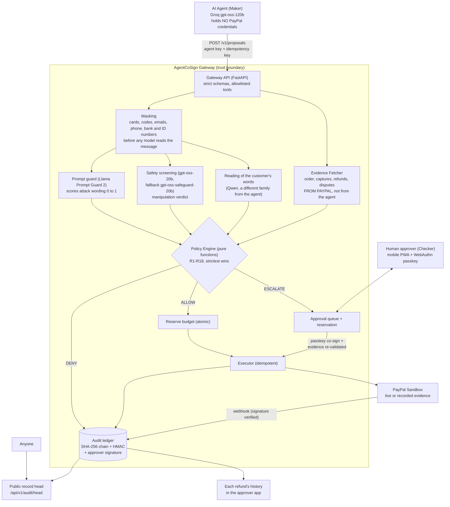
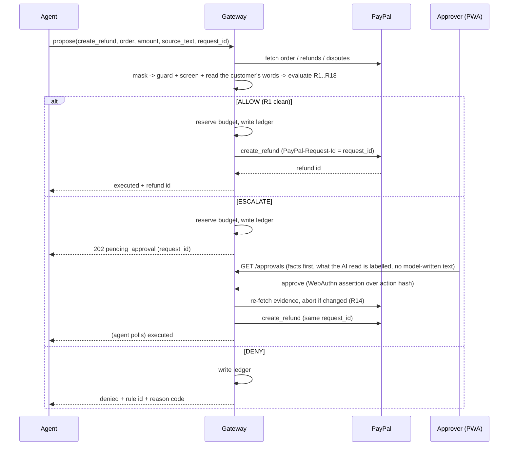
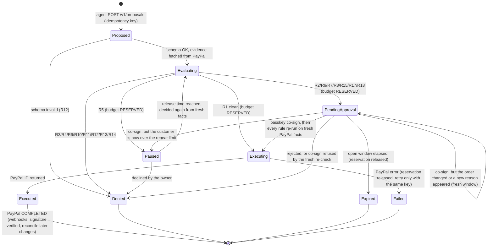

# AgentCoSign Architecture

**Version 1.2 (Oct 28, 2026)** · Companion docs: [THREAT_MODEL](THREAT_MODEL.md) · [DECISIONS](DECISIONS.md) · [TESTING](TESTING.md)

AgentCoSign is a policy gateway between an AI agent and PayPal. The agent *proposes*; deterministic code *decides*; a human *co-signs* risky actions; every step is written to a tamper-evident ledger. Sandbox only.

## 1. Core invariant

> **Probabilistic components propose and explain. Deterministic code and humans authorize and execute.** Any error, missing field, unknown tool or inconsistent evidence results in DENY (fail closed).

## 2. Component view



## 3. Trust boundaries

| Boundary | Rule |
|---|---|
| Agent ↔ Gateway | Agent is **untrusted**. Its arguments are claims. It can only call 3 allowlisted tools (refund, dispute acceptance, payout); unknown tool = DENY. |
| Gateway ↔ PayPal | Only the gateway holds PayPal credentials. Facts used by policy (captured amount, prior refunds, dispute state, customer ID, currency) come **from PayPal**. A mismatch with the agent's claim = DENY (R14). |
| Gateway ↔ LLMs | Model output is **untrusted text**. It is schema-validated, never executed, never rendered as HTML, and never the final decision. Screening and extraction models are given no tools. |
| Gateway ↔ Approver | Approver is a separate principal with a passkey. The agent's key cannot approve; the approver cannot propose. |
| Gateway ↔ Storage | Ledger rows are chained with SHA-256 and authenticated with an HMAC whose key is **not** in the database. |

## 4. Proposal lifecycle



State machine (every transition appends to the audit ledger):



- **Idempotency:** `request_id` is the PayPal request ID and the local unique key. A replay returns the original outcome and never executes twice.
- **Reservations:** budget for R4 (cumulative refunds) and R10 (rolling 24h cap) is reserved atomically at decision time and released on expiry or failure, so two concurrent requests cannot both pass.
- **Async to the agent:** `pending_approval` is a terminal response for that agent turn; the agent polls `GET /v1/proposals/{id}`. An LLM loop never blocks on a human. Decision rationale: [DECISIONS](DECISIONS.md) ADR-004 and ADR-005.

## 5. Run modes and graceful degradation ("anywhere testable")

The **decision plane** (policy, evidence handling, approval, ledger) is always real code. Only the **dependencies** degrade, and each degradation is shown on a status banner and in `/health`.

| Mode | LLM | PayPal execution | Credentials | Used for |
|---|---|---|---|---|
| **Hermetic** (default for a fresh clone) | Recorded answers (replay) | Recorded real-sandbox evidence | None | Fresh clone, CI, offline review |
| **Live-LLM** | Groq | Recorded | Model key | Prompt development |
| **Live** (the hosted demo) | Groq, live | PayPal sandbox, live | Model key, PayPal sandbox app | The public demo, acceptance runs, evidence |

Switches: `AGENTCOSIGN_REPLAY_MODE`, `AGENTCOSIGN_PAYPAL_EXECUTION` (see `.env.example`).

**When a dependency fails** (per request; in every case money only ever moves less, never more):

1. PayPal unreadable when a request arrives → the rules have no evidence and refuse it (fail closed); unreadable at approval → the approval is refused and the request stays open; a refund call with no answer → the request stays "sending" and is retried only with the same PayPal-Request-Id after PayPal is read again, so it can never go out twice. PayPal refusing the app's credentials is reported as its own step ("nothing was sent").
2. A model fails (429, 5xx, timeout, cut-off or unreadable answer) → the role's fallback model → if both fail, that check counts as "could not run": screening or the reading not run means the merchant decides; the prompt guard not run leaves screening to decide. A model never approves anything.
3. No passkey on the device → no approval is possible; there is no lower-assurance fallback.
4. Hosted service asleep or down → a keep-awake ping every 10 minutes during the judging window; otherwise `docker run` from the repo or the demo video.

### Staying available under public traffic

The hosted demo is public and runs on free tiers, so protection is layered from the process outward. Nothing is gated behind a login or CAPTCHA: everyone gets the full scripted product. Only the scarce live resource, model calls, is budgeted; PayPal sandbox calls are bounded through the test runs that make them (DECISIONS ADR-022).

| Layer | What it does | Holds if client identity is forged? |
|---|---|---|
| Body-size cap | Refuses oversized requests before any route runs | Yes |
| Per-client token buckets | Fairness between callers, by kind of work (general, live model, live execution) | No (fairness only) |
| Penalty box | Callers that keep being refused are blocked for a doubling interval | No |
| In-flight cap with reviewer reserve | Fast 503 instead of queueing; some slots only reviewers may use | Yes |
| Daily live pools, split public and reviewer | Public abuse can never spend the reviewers' share | Yes |
| Visitor allowances | Each visitor workspace runs at most 15 test runs a day, checked before any shared budget is spent; at most 5 setups per address a day; at most 200 open workspaces | Partly (per workspace yes, per address no) |
| Provider quota feedback | Each model's own remaining daily quota (response headers) is tracked; the tightest decides: public runs stop when any model runs low, all runs stop when one runs out | Yes |
| Spent budget | A test run that cannot start is refused before anything is created, and the visitor is told "No money moved" first | Yes |

Webhook verification has its own shared budget of 30 calls a minute, spent only after the cheap checks (headers present, certificate address `https` on `paypal.com`), because anyone can post to that address and rotating addresses defeats per-client limits. Past the budget the answer is 429 and PayPal retries the delivery.

`/health` is exempt from limits and also answers `HEAD`, so uptime monitors and the daily check can always reach it. It reports `capacity` as `normal`, `public_replay` or `replay_only`. Per-client state is bounded (least recently used eviction) so address rotation cannot exhaust memory. In-process limits cannot absorb a volumetric flood: that needs an edge in front (see the decision log).

**Model availability is measured, not assumed.** A model that appears in a provider's catalogue can still return 404 for a given account, and free-tier limits differ per model (the screening classifier allows 3 requests per minute, the general models 1,000 requests per day). The startup probe therefore makes a real one-token request to each configured model, falls back along the configured chain, and treats HTTP 429 as "use the next model now", never as a reason to wait. A model chain that cannot answer at all degrades as in step 2.

## 6. Data model (SQLite, WAL)

| Table | Purpose |
|---|---|
| `proposals` | One row per request: request_id (primary key, idempotency), payload_hash (a reused id with different contents is refused), tool, order, customer and payee keys, amount (decimal text), currency, state, decision, deciding and triggered rules, evidence snapshot, decided and release times, PayPal refund id and status. Money held for open requests is a state of the row (waiting, on hold, sending), so limits count it without a separate table |
| `audit` | Append-only chain: seq, created_at, request_id, event, body (canonical JSON), prev_hash, entry_hash, mac (HMAC with a key kept outside the database) |
| `passkeys` | Approver passkeys: credential id, public key, sign count, approver name |
| `passkey_challenges` | One-time WebAuthn challenges by purpose, with expiry |
| `messages` | Customer messages, masked before they are kept; only their digest goes into the chain |
| `message_checks` | The AI checks' results for a request, kept so approval and release reuse them instead of asking the models again |
| `controls` | The emergency stop and its history |
| `webhook_events` | Verified PayPal events by id, so a re-delivered event is recognised as a duplicate |

Amounts are stored as decimal strings. Parameterised queries only. On the hosted demo every visitor gets a private workspace: its own database file and its own signing secret derived from the audit key; workspaces are kept in the instance and cleared when it restarts or sleeps.

## 7. API surface (v1)

Built:

| Method | Path | Principal | Purpose |
|---|---|---|---|
| POST | `/v1/proposals` | agent key | Submit a refund request |
| GET | `/v1/proposals/{id}` | agent key | Outcome and the customer line to send |
| POST | `/v1/approver/enrolment/options`, `/v1/approver/enrolment` | operator key or one-time setup link | Enrol an approver passkey |
| POST | `/v1/approver/session/options`, `/v1/approver/session` | approver passkey | Open a 10-minute session |
| GET | `/v1/approvals/home` | approver session | Everything the merchant's home shows; the server decides each request's section and whether it can be refunded |
| GET | `/v1/approvals/stream` | approver session | Live "something changed" hints (server-sent events, no money details) |
| GET | `/v1/approvals/done` | approver session | Requests that ended in the last 24 hours |
| GET | `/v1/approvals/{id}/history` | approver session | One request's history and whether the chain verifies |
| POST | `/v1/approvals/{id}/options`, `/approve`, `/reject` | approver session plus a per-decision passkey signature bound to the request | Decide one request |
| POST | `/v1/controls/{stop,resume}` (with options) | approver session plus a passkey signature | Emergency stop of every money action; only the merchant's passkey resumes |
| POST | `/v1/webhooks/paypal` | PayPal (verified) | Refund and dispute events, trusted only after PayPal's `verify-webhook-signature` answers SUCCESS |
| GET | `/api/v1/audit/head` | public | The latest record entry, to publish and check later |
| POST | `/v1/demo/workspaces` | public (hosted demo only) | Open a private visitor workspace with a one-time setup token |
| GET, POST | `/v1/demo/scenarios`, `/v1/demo/scenarios/{key}`, `/v1/demo/messages` | approver session (demo only) | List and run test scenarios on real sandbox orders, or the visitor's own customer message |
| GET | `/v1/demo/trace?after=N` | approver session (demo only) | The visitor's own live step record for the behind-the-scenes panel |
| POST | `/api/v1/reviewer/session` | reviewer token | Roomier limits and the reserved budget share for reviewers |
| GET | `/health`, `/api/v1/config/policy` | public | Liveness and modes (`paypal_execution`, `ai_models`, `capacity`); policy limits |

All `/v1` and `/api` responses are `Cache-Control: no-store`.

### Behind the scenes (hosted demo)

Every layer reports what it did into the visitor's own step record (the last 200 steps, in memory): each PayPal call with method, path, HTTP status, time, the PayPal-Request-Id and PayPal's own id and status for what it returned; each model's answer and whether it was the primary or the fallback; the prompt guard score, screening verdict and the reading; the rules' decision in words with every check that fired; passkey checks; each record entry with its hash prefix and chain link; and one closing block per run saying what happened to the money ("sent" only when PayPal returned COMPLETED). Steps never carry bodies, credentials, tokens or unmasked customer text, and a visitor reads only their own workspace's steps.

## 7b. PayPal API surface (and what we deliberately do not use)

Every API below is justified by a specific requirement. Anything without a requirement is rejected to avoid building and maintaining code we do not need. Facts marked *verify* are settled by a sandbox spike, not assumed.

| API | Requirement it satisfies | Tier | Notes |
|---|---|---|---|
| OAuth2 token (`POST /v1/oauth2/token`) | Authenticate server-side; token refresh (PayPal documents 3-8 h; observed `expires_in` 32,340 s, about 9 h) | P0 | Credentials never reach the agent |
| Orders v2: create, capture, get | Fixture creation for tests and recorded evidence; **Evidence Fetcher** reads order, payer, currency, capture status | P0 | **Verified (spike S1/S2, Oct 9):** a card `payment_source` with `intent=CAPTURE` creates and captures in one call (HTTP 201, `COMPLETED`, ~4 s). `GET order` lists refunds in `purchase_units[0].payments.refunds[]`, each carrying `seller_payable_breakdown.total_refunded_amount` (cumulative), and the capture status becomes `PARTIALLY_REFUNDED`, so the Evidence Fetcher reads captured amount and prior refunds in one call. Card orders expose only brand, last four digits and name, **no payer ID or email**, so the R5 customer key is `payer.payer_id` when present, otherwise a card fingerprint (the final customer-key rule is fixed before the policy engine is built) |
| Payments v2: get capture, **refund capture**, get refund | The money-out action for R1/R2; the capture is the object that is refunded | P0 | Partial refunds repeat up to the captured total. **Verified:** sandbox refunds return `COMPLETED` immediately (~1.7 s) and PayPal itself rejects an over-refund with HTTP 422 `REFUND_AMOUNT_EXCEEDED`, a second line of defence behind R4 (we still enforce R4 first so the agent gets our reason code and nothing reaches PayPal) |
| **Idempotency** (`PayPal-Request-Id` header) | No double refund on retries (T5) | P0 | Same ID returns the earlier request's status; **omitting it duplicates the request**; concurrent requests with one ID can fail, so the gateway serialises per `request_id`. **Verified (S2):** replaying a refund with the same `PayPal-Request-Id` returned HTTP 200 with the *same* refund ID (first call was 201) and no second refund. **Measured (Oct 13):** after 22.8 h the same refund request id still returned the same refund and no second one; the local ledger is authoritative beyond PayPal's window and the executor reads PayPal before any retry |
| Customer Disputes v1: list (filter by `disputed_transaction_id`), get, **accept claim** | R6 (open dispute on order) and R7 (conceding funds) | P0 | `disputed_transaction_id` cannot be combined with a time filter. Dispute creation is limited-release, so sandbox disputes may need seeded/recorded evidence (S5). Accept-claim path and body: *verify* |
| Webhooks: `verify-webhook-signature` | Trust inbound events; link outcomes to the ledger (T10) | P0/P1 | Check `verification_status == SUCCESS` in the body (HTTP 200 alone is not enough). Simulator events cannot be verified, so test with real sandbox refunds. Reject unverified events; never write them to the ledger |
| Webhook events: `PAYMENT.CAPTURE.REFUNDED`, `CUSTOMER.DISPUTE.CREATED/UPDATED/RESOLVED` (+ capture reversal/denial, *verify* names) | **Reconcile out-of-band activity**: a human refunding in the PayPal dashboard or a new dispute must update R4/R6/R10 counters | P1 | Replaces polling and avoids Transaction Search |
| Transaction Search v1 (`GET /v1/reporting/transactions`) | **Daily reconciliation only**: compare ledger vs PayPal to catch out-of-band refunds/reversals; auditor evidence (US6) | P2 | Official limits: results can lag **up to 3 hours**, max range **31 days**, history 3 years, scope `reporting/search/read` must be granted to the app, `last_refreshed_datetime` tells freshness. Never used to gate a live decision |
| Payouts v1 (batch create/get) | R8/R9 contractor payouts | P1, gated on S4 | `sender_batch_id` exact-duplicate protection exists; R9 adds semantic duplicates |

**Rejected on purpose**

| API | Why not |
|---|---|
| Transaction Search for **real-time** R5/R10 | Official docs: up to 3 h delay. The ledger (we are the only executor) plus webhooks give the same facts sooner. Kept only for the P2 daily reconciliation above |
| Balances (`/v1/reporting/balances`), balance-net-summary, daily-summary | Same up-to-3 h delay (balances) and aggregate-only data: cannot gate a decision or explain a single action. `available_balance`/`withheld_balance` could become an *advisory* line in the approver UI (P2), never a rule input |
| Invoicing (`record_refund_for_invoice`, `record_payment_for_invoice`), `pay_order` | Alternative money-movement paths that would bypass the gateway; disabled, and unknown tools are denied (R12) |
| Subscriptions, Catalog, Shipment Tracking | Not in scope; no requirement |
| PayPal Login / Identity | Approver identity is our own WebAuthn passkey; PayPal OAuth login adds flow and scope with no benefit here |
| Disputes create / provide-evidence / cancel | Limited-release and outside the control-plane scope |
| Balances / Orders authorize+void | No requirement; refunds apply to captures, and orders with `AUTHORIZE` intent are denied until captured |
| `paypal-agent-toolkit` as a hard dependency | Installs ~150 transitive packages (including chromadb, selenium, kubernetes, crewai-tools) for four REST calls, caps Python below 3.14 and pins `crewai-tools==0.13.2`. Our `httpx` client is small; an optional adapter can wrap the toolkit later |

## 8. Code layout and import rules

```
agentcosign/
  api/        HTTP only         -> services, schemas, core
  services/   business logic    -> clients, models, core   (policy_engine is pure: no I/O)
  clients/    PayPal, Groq, recorded replay clients          -> core, models
  schemas/    Pydantic edge models
  models/     dataclasses and enums
  core/       config, exceptions, logging
```

## 9. Implementation status (honest, Oct 28, 2026)

| Component | Status |
|---|---|
| Config loader (strict, fail-closed), health endpoint, security headers, domain types | **Built, tested** |
| Policy engine R1 to R18 (113-row scenario table, property tests for bounded loss), evidence fetcher, idempotent executor, signed ledger with reservations, emergency stop, reconciliation | **Built, tested**; decision p95 0.033 ms (rules) and 14.4 ms (with the record write) |
| AI layer: masking, prompt guard, screening, reading of the customer's words, refund assistant | **Built**; measured on 60 labelled threads (README Results) |
| Approver PWA with WebAuthn passkey co-sign bound to the exact refund | **Built**; tested on a real Android phone and in Chrome against the PayPal sandbox |
| PayPal webhooks (signature verified by PayPal) | **Built**; verified end to end on the hosted demo, a fake event refused |
| Hosted demo: visitor workspaces, scenarios, behind-the-scenes panel, live model budget | **Built and live** on Render, live PayPal sandbox and live models |
| Git hooks and CI (lint, types, security scan, tests on Python 3.12 and 3.13, container smoke test, full-history secret scan) | **Built, green** |
| A full record browser for auditors; payouts adapter; native Android approver | **Not built** |

## 10. Production path (deliberately out of the prototype)

Multi-tenant policy store and RBAC/SSO · KMS/HSM-held audit and signing keys · Postgres with row-level append-only enforcement · SIEM export · PayeeRiskProvider with OFAC/AML screening · PayPal production onboarding and partner review · SOC 2 control mapping (access control, change management, logging, availability).
