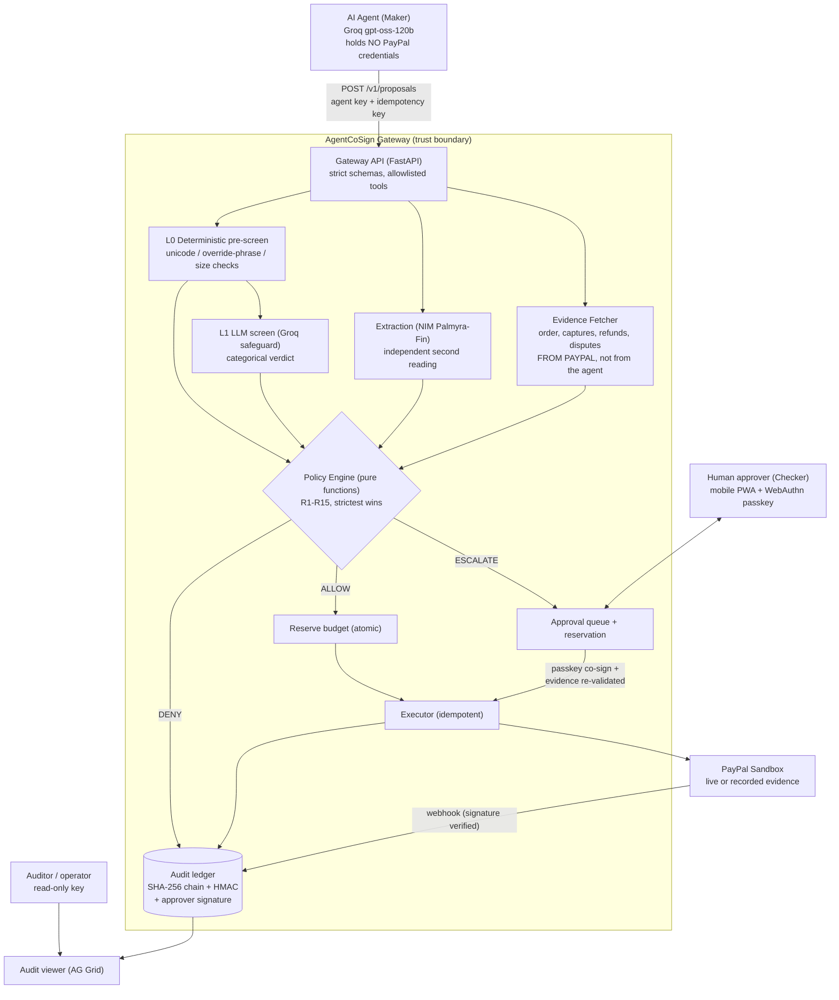

# AgentCoSign Architecture

**Version 1.1** · Companion docs: [THREAT_MODEL](THREAT_MODEL.md) · [DECISIONS](DECISIONS.md) · [TESTING](TESTING.md)

AgentCoSign is a policy gateway between an AI agent and PayPal. The agent *proposes*; deterministic code *decides*; a human *co-signs* risky actions; every step is written to a tamper-evident ledger. Sandbox only.

## 1. Core invariant

> **Probabilistic components propose and explain. Deterministic code and humans authorize and execute.** Any error, missing field, unknown tool or inconsistent evidence results in DENY (fail closed).

## 2. Component view



## 3. Trust boundaries

| Boundary | Rule |
|---|---|
| Agent ↔ Gateway | Agent is **untrusted**. Its arguments are claims. It can only call 4 allowlisted tools; unknown tool = DENY. |
| Gateway ↔ PayPal | Only the gateway holds PayPal credentials. Facts used by policy (captured amount, prior refunds, dispute state, customer ID, currency) come **from PayPal**. A mismatch with the agent's claim = DENY (R14). |
| Gateway ↔ LLMs | Model output is **untrusted text**. It is schema-validated, never executed, never rendered as HTML, and never the final decision. Screening and extraction models are given no tools. |
| Gateway ↔ Approver | Approver is a separate principal with a passkey. The agent's key cannot approve; the approver cannot propose. |
| Gateway ↔ Storage | Ledger rows are chained with SHA-256 and authenticated with an HMAC whose key is **not** in the database. |

## 4. Proposal lifecycle

```mermaid
sequenceDiagram
    participant A as Agent
    participant G as Gateway
    participant P as PayPal
    participant H as Approver (PWA)
    A->>G: propose(create_refund, order, amount, source_text, request_id)
    G->>P: fetch order / refunds / disputes
    G->>G: screen -> extract -> evaluate R1..R15
    alt ALLOW (R1 clean)
        G->>G: reserve budget, write ledger
        G->>P: create_refund (PayPal-Request-Id = request_id)
        P-->>G: refund id
        G-->>A: executed + refund id
    else ESCALATE
        G->>G: reserve budget, write ledger
        G-->>A: 202 pending_approval (request_id)
        H->>G: GET /approvals (facts first, AI summary labelled advisory)
        H->>G: approve (WebAuthn assertion over action hash)
        G->>P: re-fetch evidence; abort if changed (R14)
        G->>P: create_refund (same request_id)
        G-->>A: (agent polls) executed
    else DENY
        G->>G: write ledger
        G-->>A: denied + rule id + reason code
    end
```

State machine (every transition appends to the audit ledger):

```mermaid
stateDiagram-v2
    [*] --> Proposed: agent POST /v1/proposals (idempotency key)
    Proposed --> Evaluating: schema OK, evidence fetched from PayPal
    Proposed --> Denied: schema invalid (R12)
    Evaluating --> Denied: R3/R4/R9/R10/R11/R12/R13/R14
    Evaluating --> PendingApproval: R2/R5/R6/R7/R8/R15 (budget RESERVED)
    Evaluating --> Executing: R1 clean (budget RESERVED)
    PendingApproval --> Executing: passkey co-sign, evidence re-validated (R14)
    PendingApproval --> Denied: rejected
    PendingApproval --> Expired: TTL elapsed (reservation released)
    Executing --> Executed: PayPal ID returned
    Executing --> Failed: PayPal error (reservation released; retry only with the same key)
    Executed --> Confirmed: webhook (signature verified) or poll
    Denied --> [*]
    Expired --> [*]
    Failed --> [*]
    Confirmed --> [*]
```



- **Idempotency:** `request_id` is the PayPal request ID and the local unique key. A replay returns the original outcome and never executes twice.
- **Reservations:** budget for R4 (cumulative refunds) and R10 (rolling 24h cap) is reserved atomically at decision time and released on expiry or failure, so two concurrent requests cannot both pass.
- **Async to the agent:** `pending_approval` is a terminal response for that agent turn; the agent polls `GET /v1/proposals/{id}`. An LLM loop never blocks on a human. Decision rationale: [DECISIONS](DECISIONS.md) ADR-004 and ADR-005.

## 5. Run modes and graceful degradation ("anywhere testable")

The **decision plane** (policy, evidence handling, approval, ledger) is always real code. Only the **dependencies** degrade, and each degradation is shown on a status banner and in `/health`.

| Mode | LLM | PayPal execution | Credentials | Used for |
|---|---|---|---|---|
| **Hermetic** (default) | Recorded answers (replay) | Recorded real-sandbox evidence | None | Fresh clone, CI, judges, hosted fallback |
| **Live-LLM** | Groq / NIM | Recorded | LLM keys | Prompt development |
| **Live-sandbox** | Replay or live | PayPal sandbox | PayPal sandbox keys | Recording evidence, hosted demo |

Switches: `AGENTCOSIGN_REPLAY_MODE`, `AGENTCOSIGN_PAYPAL_EXECUTION` (see `.env.example`).

**Degradation ladder** (automatic, per request):

1. Live sandbox call fails or times out (circuit breaker opens) → execution falls back to *recorded evidence*, banner turns amber, ledger notes `execution=recorded`.
2. Primary LLM fails (429/5xx/garbled) → fallback model → recorded answer for scripted scenarios → for free-form input **ESCALATE** (R15), never allow.
3. Approver passkey unavailable on the device → `session` assurance (explicitly labelled lower assurance, recorded in the ledger).
4. Hosted service cold or down → `docker compose up` or the committed demo video.

## 6. Data model (SQLite, WAL)

| Table | Purpose |
|---|---|
| `proposals` | request_id (PK, idempotency), tool, canonical payload, payload_hash, state, created/expires |
| `reservations` | request_id, amount, currency, expires — counts toward R4/R10 until executed or released |
| `audit_ledger` | seq, ts, request_id, event, rule ids, decision, actor, amount (TEXT decimal), prev_hash, entry_hash, hmac, approver_sig, assurance, paypal_id |
| `evidence_cache` | PayPal facts snapshot (hash) used at decision time, for R14 comparison |

Amounts are stored as decimal strings. Parameterised queries only. The hosted demo re-seeds deterministically on boot; recorded evidence lives in the repo under `docs/evidence/`.

## 7. API surface (v1)

| Method | Path | Principal | Purpose |
|---|---|---|---|
| POST | `/v1/proposals` | agent | Submit an action proposal |
| GET | `/v1/proposals/{id}` | agent | Poll outcome |
| GET | `/v1/approvals` | approver | Pending co-sign requests |
| POST | `/v1/approvals/{id}/decision` | approver | Approve (WebAuthn assertion) / reject |
| GET | `/v1/audit` · `/v1/audit/verify` · `/v1/audit/head` | operator | Read ledger, verify chain, signed head hash |
| POST | `/v1/webhooks/paypal` | PayPal (signature-verified) | Outcome linking |
| GET | `/health` · `/api/v1/config/policy` | public | Liveness + modes; policy limits |

## 7b. PayPal API surface (and what we deliberately do not use)

Every API below is justified by a specific requirement. Anything without a requirement is rejected to avoid building and maintaining code we do not need. Facts marked *verify* are settled by a sandbox spike, not assumed.

| API | Requirement it satisfies | Tier | Notes |
|---|---|---|---|
| OAuth2 token (`POST /v1/oauth2/token`) | Authenticate server-side; token refresh (PayPal documents 3-8 h; observed `expires_in` 32,340 s, about 9 h) | P0 | Credentials never reach the agent |
| Orders v2: create, capture, get | Fixture creation for tests and recorded evidence; **Evidence Fetcher** reads order, payer, currency, capture status | P0 | **Verified (spike S1/S2, Oct 9):** a card `payment_source` with `intent=CAPTURE` creates and captures in one call (HTTP 201, `COMPLETED`, ~4 s). `GET order` lists refunds in `purchase_units[0].payments.refunds[]`, each carrying `seller_payable_breakdown.total_refunded_amount` (cumulative), and the capture status becomes `PARTIALLY_REFUNDED`, so the Evidence Fetcher reads captured amount and prior refunds in one call. Card orders expose only brand, last four digits and name, **no payer ID or email**, so the R5 customer key is `payer.payer_id` when present, otherwise a card fingerprint (the final customer-key rule is fixed before the policy engine is built) |
| Payments v2: get capture, **refund capture**, get refund | The money-out action for R1/R2; the capture is the object that is refunded | P0 | Partial refunds repeat up to the captured total. **Verified:** sandbox refunds return `COMPLETED` immediately (~1.7 s) and PayPal itself rejects an over-refund with HTTP 422 `REFUND_AMOUNT_EXCEEDED`, a second line of defence behind R4 (we still enforce R4 first so the agent gets our reason code and nothing reaches PayPal) |
| **Idempotency** (`PayPal-Request-Id` header) | No double refund on retries (T5) | P0 | Same ID returns the earlier request's status; **omitting it duplicates the request**; concurrent requests with one ID can fail, so the gateway serialises per `request_id`. **Verified (S2):** replaying a refund with the same `PayPal-Request-Id` returned HTTP 200 with the *same* refund ID (first call was 201) and no second refund. Retention is about 6 h per Orders docs (*still to verify for refunds*); the local ledger is authoritative beyond that and the executor does GET-before-retry |
| Customer Disputes v1: list (filter by `disputed_transaction_id`), get, **accept claim** | R6 (open dispute on order) and R7 (conceding funds) | P0 | `disputed_transaction_id` cannot be combined with a time filter. Dispute creation is limited-release, so sandbox disputes may need seeded/recorded evidence (S5). Accept-claim path and body: *verify* |
| Webhooks: `verify-webhook-signature` | Trust inbound events; link outcomes to the ledger (T10) | P0/P1 | Check `verification_status == SUCCESS` in the body (HTTP 200 alone is not enough). Simulator events cannot be verified, so test with real sandbox refunds. Reject unverified events; never write them to the ledger |
| Webhook events: `PAYMENT.CAPTURE.REFUNDED`, `CUSTOMER.DISPUTE.CREATED/UPDATED/RESOLVED` (+ capture reversal/denial, *verify* names) | **Reconcile out-of-band activity**: a human refunding in the PayPal dashboard or a new dispute must update R4/R6/R10 counters | P1 | Replaces polling and avoids Transaction Search |
| Transaction Search v1 (`GET /v1/reporting/transactions`) | **Daily reconciliation only**: compare ledger vs PayPal to catch out-of-band refunds/reversals; auditor evidence (US6) | P2 | Official limits: results can lag **up to 3 hours**, max range **31 days**, history 3 years, scope `reporting/search/read` must be granted to the app, `last_refreshed_datetime` tells freshness. Never used to gate a live decision |
| Payouts v1 (batch create/get) | R8/R9 contractor payouts | P1, gated on S4 | `sender_batch_id` exact-duplicate protection exists; R9 adds semantic duplicates |

**Rejected on purpose**

| API | Why not |
|---|---|
| Transaction Search for **real-time** R5/R10 | Official docs: up to 3 h delay. The ledger (we are the only executor) plus webhooks give the same facts sooner. Kept only for the P2 daily reconciliation above |
| Balances (`/v1/reporting/balances`), balance-net-summary, daily-summary | Same up-to-3 h delay (balances) and aggregate-only data: cannot gate a decision or explain a single action. `available_balance`/`withheld_balance` could become an *advisory* line in the approver UI (P2), never a rule input |
| Invoicing (`record_refund_for_invoice`, `record_payment_for_invoice`), `pay_order` | Alternative money-movement paths that would bypass the gateway; disabled, and unknown tools are denied (R12) |
| Subscriptions, Catalog, Shipment Tracking | Not in scope; no requirement |
| PayPal Login / Identity | Approver identity is our own WebAuthn passkey; PayPal OAuth login adds flow and scope with no benefit here |
| Disputes create / provide-evidence / cancel | Limited-release and outside the control-plane scope |
| Balances / Orders authorize+void | No requirement; refunds apply to captures, and orders with `AUTHORIZE` intent are denied until captured |
| `paypal-agent-toolkit` as a hard dependency | Installs ~150 transitive packages (including chromadb, selenium, kubernetes, crewai-tools) for four REST calls, caps Python below 3.14 and pins `crewai-tools==0.13.2`. Our `httpx` client is small; an optional adapter can wrap the toolkit later |

## 8. Code layout and import rules

```
agentcosign/
  api/        HTTP only         -> services, schemas, core
  services/   business logic    -> clients, models, core   (policy_engine is pure: no I/O)
  clients/    PayPal, Groq, NIM, recorded replay clients     -> core, models
  schemas/    Pydantic edge models
  models/     dataclasses and enums
  core/       config, exceptions, logging
```

## 9. Implementation status (honest)

| Component | Status |
|---|---|
| Config loader (strict, fail-closed), health endpoint, security headers, domain types | **Built, tested** |
| PayPal sandbox spikes S1/S2 (headless order capture, refund, idempotent replay, over-refund rejection, evidence shape) | **Verified live** (`spikes/s1_s2_order_refund.py`) |
| Git hooks (authorship, lint, format, types, secret scan, tests) and CI workflow | Hooks **built and exercised locally**; CI workflow written, not yet run |
| Policy engine R1–R15, evidence fetcher, executor, ledger, screening, extraction | Planned (G2, Oct 27) |
| PWA approver with passkey co-sign, audit viewer | Planned (G3, Nov 2) |
| Payouts adapter, webhooks, native Android | Optional (P1/P2) |

## 10. Production path (deliberately out of the prototype)

Multi-tenant policy store and RBAC/SSO · KMS/HSM-held audit and signing keys · Postgres with row-level append-only enforcement · SIEM export · PayeeRiskProvider with OFAC/AML screening · PayPal production onboarding and partner review · SOC 2 control mapping (access control, change management, logging, availability).
